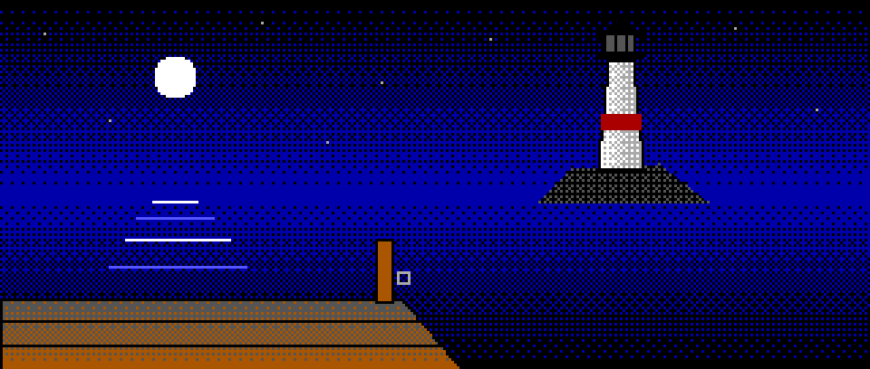

# Unlikely Memories

**Artificial Interactive Fiction.** A text adventure engine for worlds generated by AI. The AI writes a world
(its places, puzzles, characters, text and pictures) and the engine plays it in the style of the classics
(Zork, Colossal Cave, the Spanish Aventuras AD games), checking that every puzzle can be solved, every exit
leads somewhere and every danger is warned about. In English and Spanish.

**[Play it in your browser →](https://reactivo.github.io/unlikely-memories/)**

## How to play

- Click anything marked **+** to examine it, and any command shown in the story to run it.
- Type short commands: `look`, `examine door`, `take lamp`, `north` (or just `n`), `talk to the porter`.
- `help` explains the rest. `hint` points you to whatever in the world can help.
- The game saves itself after every move. `save` keeps a game you can always `load` again.

## Status

An early version. For now the worlds are generated ahead of time and played as they are. The next step is
connecting the AI to the game itself, so that each new game generates its own world as you play.

## How it's made

The AI only proposes: the engine keeps the state of the world, and nothing changes it except the engine's own
rules, so the same command always gives the same result and a world can't be broken by what the AI writes next.
Plain JavaScript modules and CSS: no framework, no build step. The pictures are not image files: each one is
a list of shapes in the 16 EGA colours, drawn with ordered dithering, the way Sierra's AGI games were.
The parser understands English and Spanish from hand-written word lists, so commands answer instantly.

## Credits

- Made by Diego García de Enterría Díaz ([reactivo](https://github.com/reactivo)).
- The worlds' text and pictures, and much of the code, were generated with [Claude](https://claude.ai)
  (Anthropic), under Diego's direction.
- Font: [m5x7](https://managore.itch.io/m5x7) by Daniel Linssen (CC0).

## Licence

- **Code**: [MIT](LICENSE).
- **Worlds** (their text, pictures and sprites, in `worlds/`) and the logo:
  [CC BY 4.0](https://creativecommons.org/licenses/by/4.0/). Reuse them freely, with credit to Unlikely Memories.
